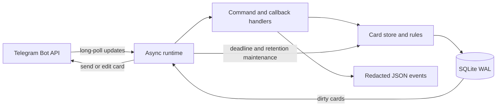

# Architecture

RallyPoint is a single Python process, a local SQLite database, and Telegram's Bot API over HTTPS. Python 3.12 was selected for its mature async HTTP tooling, standard-library SQLite, typing, and approachable deployment. Rust's runtime guarantees are attractive but would increase implementation and review effort for this low-throughput bot.

## Module responsibilities

| Package | Responsibility |
|---|---|
| `bot` | Telegram updates, commands, callback routing, and card presentation |
| `core` | Configuration, runtime lifecycle, and CLI coordination |
| `features` | Pact domain rules and shared models |
| `security` | Scoped identity derivation and abuse controls |
| `storage` | SQLite access, migrations, transactions, offsets, and dirty state |
| `observability` | Structured logs and redaction |
| `integrations` | Explicit Telegram HTTP adapter and API error translation |

## State and consistency

`OPEN ↔ READY` while the cutoff is in the future. At the cutoff, OPEN becomes MISSED and READY becomes MET. An authorised cancellation makes a nonterminal card CANCELLED. The stored deadline and current count determine settlement; button text is never authoritative.

Membership rows represent intent, not toggles. Join inserts at most one row for the caller and card; Leave deletes that row. Unique constraints and transactions preserve the aggregate under duplicate callbacks. Creation stores the Telegram update ID and returns the existing card on repeated delivery. Polling offsets persist across restart.

Mutations mark cards dirty. The runtime publishes the latest database state and clears dirty state after a successful message operation. A failed edit remains retryable. This is eventual display consistency: the database is authoritative, and a Telegram card can temporarily show an older count. A deadline is resolved on the next maintenance pass after startup if the process was offline.

Telegram does not provide an idempotency key for `sendMessage`. A crash after Telegram accepts a send but before the returned message ID is persisted can produce a duplicate card on recovery. This is explicitly not end-to-end exactly-once delivery. Vote intent remains idempotent. Deploy one polling process for each token/database, not a horizontally scaled fleet.

## Storage and privacy boundaries

Cards require a title, target, deadline, status, Telegram chat/message/topic routing, creator reference, and aggregate count. Votes use `HMAC-SHA256(secret, card scope + account ID)` through Python's standard library. Raw participant account IDs and usernames are not needed in persistent vote storage. Pseudonyms differ per card, but an operator holding the secret can compute candidates.

The title is user-supplied content deliberately stored to render the feature. Users should not put secrets into titles. Terminal cards are purged after configured retention; backups need their own policy. `/forget` computes the caller's scoped key for each retained card, removing their references without a permanent global identity index.

SQLite is sufficient for one small community bot. Transactions are brief; local disk latency and table growth bound performance. PostgreSQL, background queues, and multi-worker polling are deferred until measured load justifies them.

## Operational design

Long polling avoids a public inbound endpoint. The runtime handles SIGTERM/SIGINT and closes the HTTP client and database. HTTP timeouts, Telegram retry-after errors, and transient failures are classified for bounded retries or deferred reconciliation. Production uses a dedicated unprivileged Linux account and restrictive filesystem permissions.

Logs record event names, severity, safe result categories, correlation IDs, and operational counts rather than raw update bodies. Optional rotating file output complements system journal rotation. Diagnostics expose aggregate health only to configured operator accounts in private chat.

See [API.md](API.md) for boundaries and [DEPLOYMENT.md](DEPLOYMENT.md) for operation.
